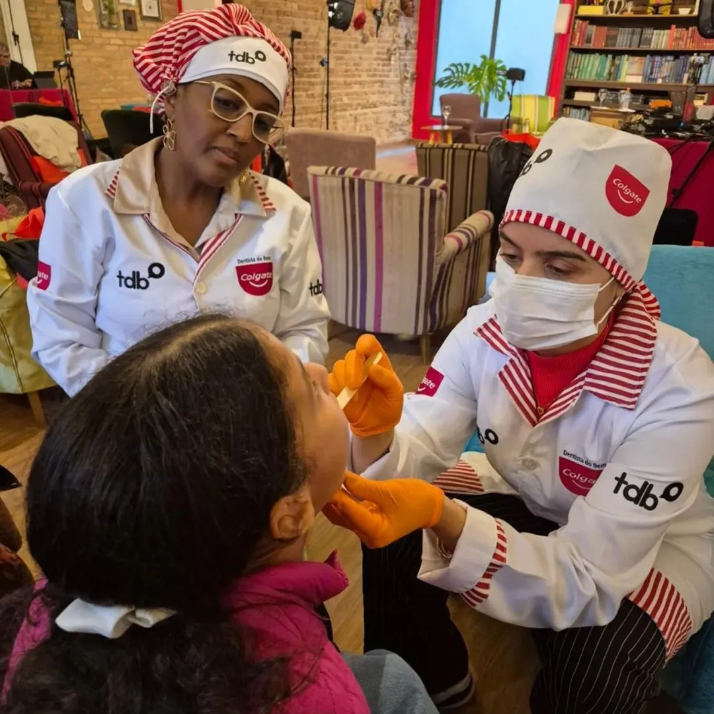

# Rede do Bem - Plataforma de apoio à Turma do Bem

https://bfvvh.github.io/tdb-plataforma-apoio/

Projeto acadêmico da turma **1TDSPA**, desenvolvido nas Sprints 1 e 2 de Front-End Design Engineering da FIAP.

A Rede do Bem é uma plataforma para aproximar a Turma do Bem de pessoas e empresas que querem ajudar. O site apresenta a ONG e as formas de apoio. O visitante pode conhecer resultados, consultar necessidades e preencher uma oferta de apoio.


## Proposta

O desafio é centralizar informações, gerenciar doadores e parceiros, automatizar processos e utilizar dados e Inteligência Artificial para apoiar decisões.

Nossa proposta combina uma área pública de captação com uma futura área interna de gestão:

- **Área pública:** apresenta histórias, resultados e colaboradores, mostra necessidades e recebe ofertas de materiais, serviços, divulgação ou apoio financeiro.
- **Área interna, prevista para etapas futuras:** reúne os dados dos apoiadores e o histórico das ofertas, organiza contatos e tarefas e apresenta indicadores para a equipe da ONG.
- **Automação e IA, previstas para etapas futuras:** lembretes de acompanhamento, sugestões de ofertas compatíveis com as necessidades, identificação de informações faltantes e auxílio na preparação de respostas. A equipe da ONG revisará as sugestões e tomará as decisões.

## O que está implementado

**Status da Sprint 2:** interface responsiva e interações implementadas em HTML, CSS e JavaScript, reaproveitando as sete páginas da Sprint 1.

- Layout adaptado para celular, tablet e desktop, com media queries.
- Menu hambúrguer com abertura e fechamento por JavaScript nas sete páginas, em telas de até 991px.
- Validação dos formulários de contato e oferta pelo JavaScript, sem o atributo `required` do HTML.
- Mensagens de erro junto aos campos, bordas de destaque e foco no primeiro campo inválido.
- Validação de seleção de necessidades, tipos de apoio e autorização de contato na oferta.
- Links dos cartões selecionam a necessidade e o tipo de apoio correspondentes e levam ao formulário, preservando escolhas anteriores.
- Botões de limpar removem os dados e os avisos de validação.
- Fonte Inter carregada localmente pela pasta `fonts`.

| Página | Objetivo |
| --- | --- |
| `index.html` | Apresentar a Rede do Bem e a ONG e direcionar o visitante para as formas de apoio. |
| `paginas/integrantes.html` | Mostrar fotos, nomes, RMs, turma e perfis dos integrantes. |
| `paginas/sobre.html` | Explicar o contexto, a proposta, as tecnologias e as próximas etapas. |
| `paginas/faq.html` | Responder dúvidas frequentes. |
| `paginas/contato.html` | Apresentar o formulário de contato. |
| `paginas/impacto.html` | Mostrar uma história de apoio, resultados e colaboradores em destaque. |
| `paginas/apoio.html` | Exibir necessidades, formulário de oferta e campo de consulta de protocolo. |

Todas as páginas possuem menu principal, a logo da Turma do Bem ao lado do nome Rede do Bem com link para o início e rodapé padronizado. As duas páginas dedicadas à solução são **Impacto e colaboradores** e **Quero apoiar**.

### Limitações do protótipo

Os formulários validam os dados e exibem uma confirmação local. As mensagens de envio representam o fluxo do protótipo: nenhum dado é enviado à ONG, armazenado ou encaminhado por e-mail. Não há backend ou banco de dados nesta etapa.

A consulta de protocolo ainda é apenas visual: o botão não retorna o andamento das ofertas.

## Como abrir

Para clonar, tenha o Git instalado no computador. Os comandos abaixo são para o terminal PowerShell do Windows.

1. Abra o terminal na pasta onde deseja salvar o projeto. Confira se o Git está disponível:

   ```powershell
   git --version
   ```

   O terminal deve mostrar a versão instalada. Se o comando não for reconhecido, instale o Git e abra o terminal novamente.

2. Clone o repositório:

   ```powershell
   git clone https://github.com/BFVVH/tdb-plataforma-apoio.git
   ```

   Esse comando baixa os arquivos e o histórico do projeto para uma nova pasta chamada `tdb-plataforma-apoio`.

3. Entre na pasta criada:

   ```powershell
   cd tdb-plataforma-apoio
   ```

4. Abra a página inicial no navegador padrão:

   ```powershell
   Start-Process .\index.html
   ```

   Você também pode abrir a pasta pelo Explorador de Arquivos e dar dois cliques em `index.html`. Depois, use o menu do site para acessar as demais páginas.

Se preferir baixar sem Git, acesse o repositório no GitHub, clique em **Code > Download ZIP**, extraia o arquivo e abra `index.html`. Mantenha a estrutura de pastas para que as imagens e o CSS carreguem corretamente.

Não é necessário instalar dependências nem iniciar um servidor.

## Como testar as interações

1. Em uma janela menor que 992px, clique em **Menu** para abrir e fechar a navegação.
2. Em **Contato**, tente enviar campos vazios ou um e-mail inválido e depois corrija os dados.
3. Em **Quero apoiar**, clique em um dos links dos cartões e confira as opções marcadas no formulário.
4. Tente enviar uma oferta sem selecionar necessidade, tipo de apoio ou autorização de contato; confira os avisos.
5. Use **Limpar formulário** para remover os dados e as mensagens.

O layout foi conferido nas sete páginas em larguras de 320, 390, 480, 768, 991, 992, 1300 e 1440px.

## Repositório e visualização

- [Repositório no GitHub](https://github.com/BFVVH/tdb-plataforma-apoio)
- [Site no Github Pages](https://bfvvh.github.io/tdb-plataforma-apoio/)

## Tecnologias

- HTML5 para a estrutura e o conteúdo.
- CSS3 em arquivo externo para o visual e a responsividade.
- JavaScript em arquivo externo para o menu, as validações e a seleção de apoio.
- Git e GitHub para versionamento e colaboração.

## Organização das pastas

```text
tdb-plataforma-apoio/
├── index.html
├── README.md
├── paginas/
│   ├── integrantes.html
│   ├── sobre.html
│   ├── faq.html
│   ├── contato.html
│   ├── impacto.html
│   └── apoio.html
├── css/
│   └── style.css
├── js/
│   └── script.js
├── fonts/
│   └── inter.ttf
└── assets/
    ├── imagens/
    │   ├── logo-tdb.png
    │   ├── tdb.jpg
    │   ├── dentista-do-bem-1.png
    │   ├── apolonias-do-bem-1.png
    │   └── integrantes/
    │       ├── felipe.jpeg
    │       ├── breno.jpeg
    │       ├── VH.jpeg
    │       └── VS.jpeg
    └── icons/
        ├── github.svg
        └── linkedin.svg
```

## Visual e CSS

O site usa um CSS externo em `css/style.css`, compartilhado por todas as páginas.

O visual mantém verde `#B5BD00` e laranja `#F28C00` como cores principais, com base na identidade da Turma do Bem, fonte Inter e conteúdo centralizado.

As media queries ajustam colunas, imagens, títulos e espaçamentos. No tablet, a marca fica à esquerda e o botão do menu à direita. No celular, a marca fica centralizada, com o botão abaixo à esquerda. No desktop, os links permanecem visíveis.

O CSS inclui reset de margens e padding, `box-sizing: border-box`, estilos compartilhados e regras para os erros dos formulários.

<hr>



## Equipe e contato

| Foto | Integrante | RM | GitHub | LinkedIn |
| --- | --- | --- | --- | --- |
|  | Felipe Rocha Sanches | 576191 | [FeRocha14](https://github.com/FeRocha14) | [Felipe Rocha](https://www.linkedin.com/in/felipe-rocha-a46196248/) |
|  | Breno Menezes de Macedo | 574875 | [BrenoMenezes20](https://github.com/BrenoMenezes20) | [Breno Menezes](https://www.linkedin.com/in/breno-menezes--/) |
|  | Victor Henrique Lima Andrade | 575563 | [Victor0Henrique](https://github.com/Victor0Henrique) | [Victor Henrique](https://www.linkedin.com/in/victor-henrique-a4996642a/) |
|  | Victor Sales Marques | 574418 | [victor-singrax](https://github.com/victor-singrax) | [Victor Sales](https://www.linkedin.com/in/victor-sales-marques/) |

## Uso de Inteligência Artificial e dados fictícios

**Foi utilizada Inteligência Artificial para auxiliar na elaboração e revisão do CSS responsivo, na implementação e explicação do JavaScript, na documentação e na escrita dos dados fictícios. O grupo revisou e modificou o código durante o desenvolvimento.**

As histórias, os nomes dos apoiadores de exemplo (Horizonte Dental, Marina Costa e Rota Solidária), as quantidades, as necessidades, as datas e os resultados demonstrativos não representam registros reais da ONG. Eles servem para ilustrar o fluxo da proposta acadêmica.


## Próximas etapas

1. Desenvolver o backend, o armazenamento de ofertas e o envio real dos formulários.
2. Implementar o painel da ONG e o acompanhamento privado por protocolo.
3. Implementar automações, indicadores e sugestões de IA, com revisão da equipe e dados validados.


## Referências e créditos

- [Site oficial da Turma do Bem](https://turmadobem.org.br/), referência institucional e visual.
- GitHub e LinkedIn: marcas representadas pelos ícones dos links sociais.
- [Inter no Google Fonts](https://fonts.google.com/specimen/Inter), fonte utilizada no site, distribuída sob a SIL Open Font License.

